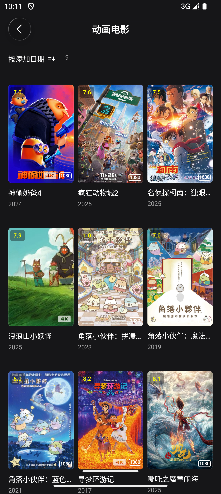
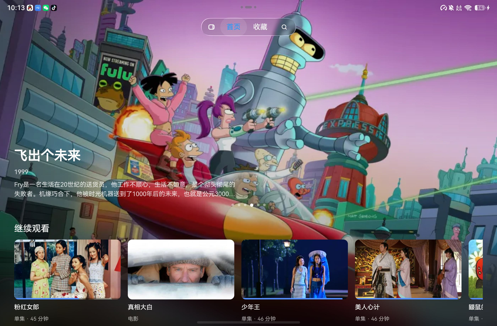

# MaFei · 马飞

**连接自己的媒体服务器，在手机、平板和桌面上浏览与观看。**

MaFei 是一款面向个人媒体库的第三方客户端，支持连接 Jellyfin，并提供飞牛影视的兼容接入。从首页的最近添加、继续观看，到海报墙、影片详情和剧集选集，把存放在服务器上的影视内容带到日常使用的设备上。

使用 MaFei 需要已有的媒体服务器和账号；影片、海报与媒体资料来自你连接的服务器，应用本身不提供影视资源。

[华为应用市场下载](https://appgallery.huawei.com/app/detail?id=cn.xiaobai.mafei) · [反馈问题](https://github.com/chashaochang/MaFei/issues) · [开发与构建](composeApp/README.md)

## 用 MaFei 做什么

- **找到想看的内容**：浏览最近添加与分类媒体库，通过搜索查找影片和剧集，查看简介、评分和演职人员。
- **接着上次观看**：从首页的继续观看回到播放进度，按季、集浏览电视剧，管理收藏与观看记录。
- **选择合适的播放方式**：提供续播、字幕、音轨、清晰度和倍速等控制，具体可用项取决于媒体源、服务器和平台播放器。
- **连接多个媒体库**：保存服务器与账号，切换不同连接，并通过局域网发现寻找服务。
- **适应不同屏幕**：手机使用紧凑导航，平板与宽屏提供侧栏和更开阔的海报布局；界面以苹果平台的视觉与交互习惯为参考。
- **管理自己的服务器**：具备相应权限的 Jellyfin 账号可进入管理控制台，查看和管理媒体库、用户、设备与活动会话。

## 看看现在的 MaFei

以下均为 **2026 年 10 月 15 日重新采集的 2.0 开发版界面**，不代表应用市场版本。手机来自 Android 模拟器，平板来自 HUAWEI MatePad 11.5 S 真机。截图选取不显示账号和服务器路径的页面，保留真实界面与媒体内容。

### 手机 · 浏览媒体与剧集

<table>
  <tr>
    <td align="center"></td>
    <td align="center"></td>
  </tr>
  <tr>
    <td align="center">媒体库与海报墙</td>
    <td align="center">剧集详情与分季浏览</td>
  </tr>
</table>

### 平板 · 首页与宽屏媒体库

截图来源与隐私检查见[截图说明](screenshots/current/README.md)。

## 下载与平台

| 平台 | 当前获取方式与状态 |
| --- | --- |
| HarmonyOS | [华为应用市场](https://appgallery.huawei.com/app/detail?id=cn.xiaobai.mafei)提供已发布版本；本仓库的 2.0 开发线面向 ARM64 手机、平板与 PC。 |
| Android | 2.0 开发中，面向 ARM64；可从源码构建，以上手机截图来自模拟器。 |
| iOS / iPadOS | 2.0 开发中，面向 ARM64；仓库包含 Xcode 宿主，尚未在此提供正式下载。 |
| macOS | 2.0 开发中，面向 Apple Silicon；仓库包含桌面入口，尚未在此提供正式下载。 |

各平台的功能和播放能力仍在逐步验证。当前开发版的已知问题与实际验证范围见[验收记录](composeApp/REFACTOR_ACCEPTANCE.md)，正式使用请以对应发布版本为准。

## 参与开发

MaFei 2.0 使用 Kotlin Multiplatform / Compose Multiplatform 共享应用逻辑与界面。环境准备、目录职责、运行及打包命令统一放在[开发文档](composeApp/README.md)；修改代码前请阅读[架构说明](composeApp/ARCHITECTURE.md)与[项目约束](AGENTS.md)。

欢迎通过 [Issue](https://github.com/chashaochang/MaFei/issues)反馈问题或提出建议。提交问题时请说明平台、应用版本和复现步骤，日志与截图中的账号、地址、令牌等个人信息请先隐藏。

## 许可证

除单独声明外，代码按 [GPL-3.0-or-later](LICENSE) 发布，第三方组件遵循各自许可证。HarmonyOS 播放器使用的 MFPlayer 是独立授权的本地 SDK，不随公开仓库分发；构建前提见[开发文档](composeApp/README.md#本地资料与依赖)。
