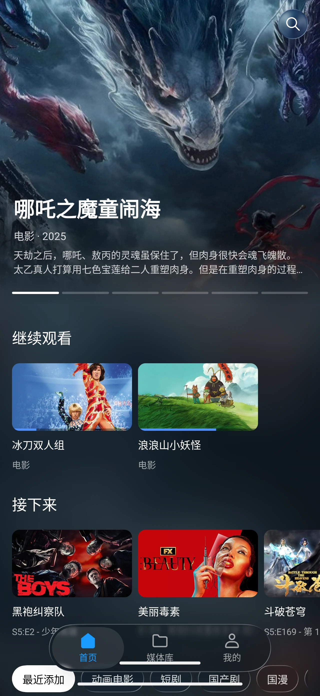
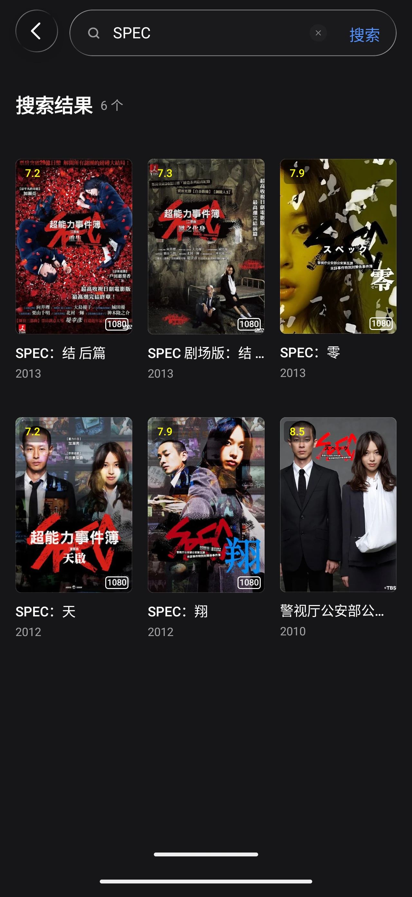
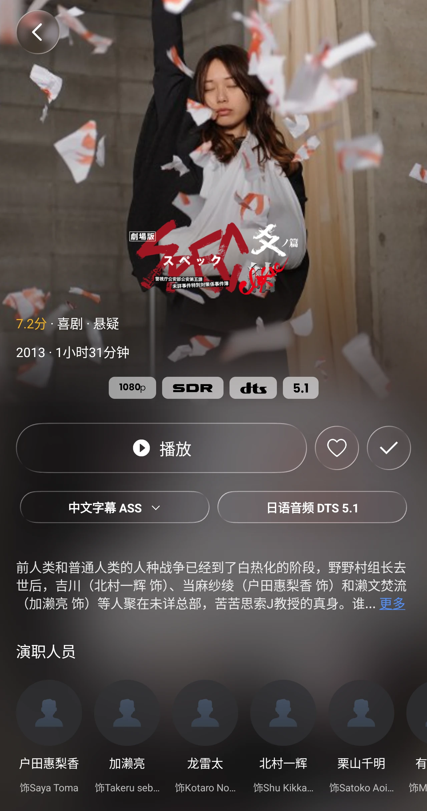
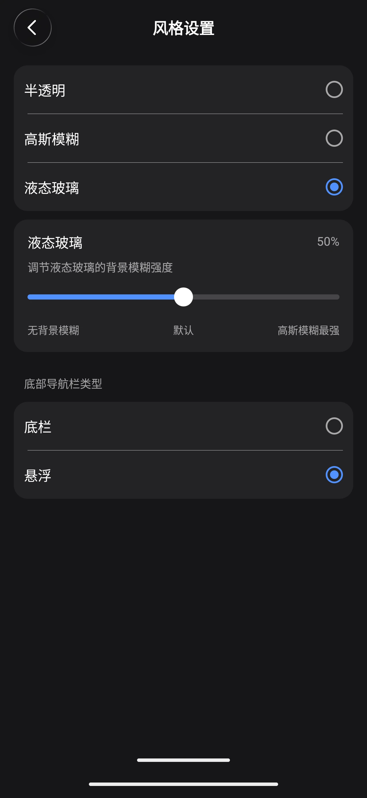
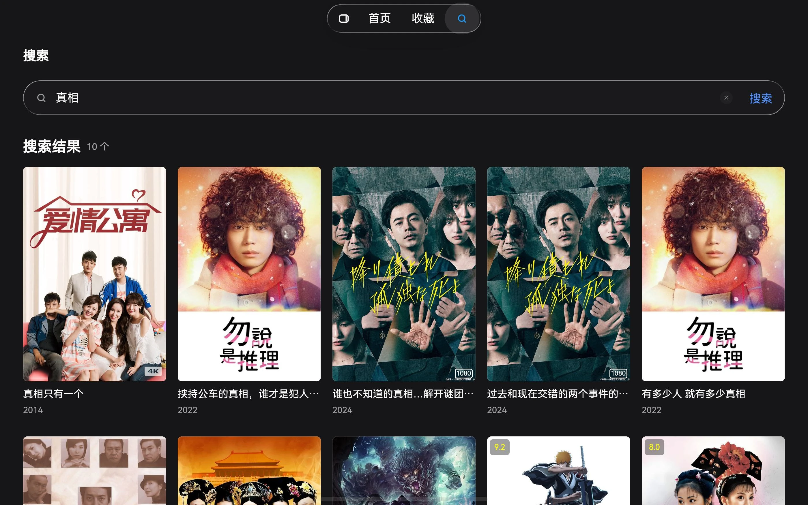
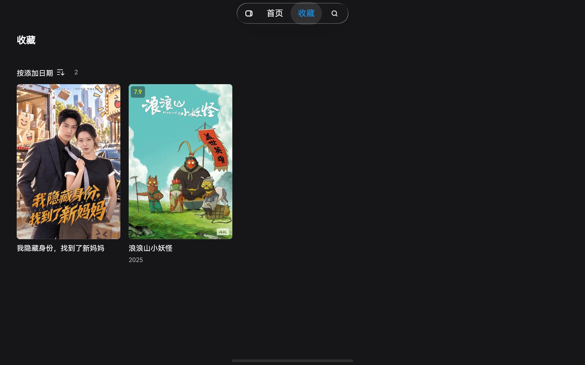
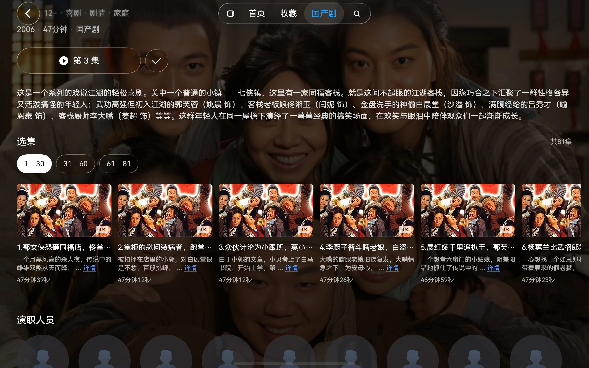

  

<h1 align="center">MaFei · 马飞</h1>

  <strong>连接你的媒体服务器，让个人媒体库在不同屏幕上自然展开。</strong>

  Jellyfin · 飞牛影视兼容接入 · 苹果风格交互 · 手机与宽屏布局

  <a href="#下载与平台">下载与平台</a> ·
  <a href="#核心体验">核心体验</a> ·
  <a href="#界面预览">界面预览</a> ·
  <a href="#快速开始">快速开始</a> ·
  <a href="composeApp/README.md">开发文档</a> ·
  <a href="https://github.com/chashaochang/MaFei/issues">反馈问题</a>

MaFei 是一款面向个人媒体库的独立第三方客户端。连接自己的 Jellyfin 或飞牛影视服务，从最近添加、继续观看到海报墙与剧集选集，在熟悉的媒体内容之间浏览、发现与观看。

> **2.0 正在开发中。** 下方截图展示开发版界面，不代表应用市场版本或各平台均已正式可用；下载渠道与开发状态见[平台说明](#下载与平台)。

## 核心体验

- **自己的媒体库，集中浏览**：连接 Jellyfin 或兼容接入飞牛影视，保存服务器与账号，在不同连接间切换。
- **从发现到接着看**：浏览最近添加、搜索影片、管理收藏，从继续观看回到进度；电影详情、分季与选集让内容脉络更清楚。
- **小屏紧凑，宽屏舒展**：手机使用紧凑导航，平板与宽屏提供侧栏和更开阔的海报布局，视觉与交互以苹果平台习惯为参考。
- **按内容选择播放方式**：提供续播、字幕、音轨、清晰度与倍速等控制，具体可用项取决于媒体源、服务器与平台播放器，开发版仍在逐端验证。

具备相应权限的 Jellyfin 账号还可进入管理控制台，查看和管理媒体库、用户、设备与活动会话。

## 下载与平台

**HarmonyOS 已发布版本：** [前往华为应用市场](https://appgallery.huawei.com/app/detail?id=cn.xiaobai.mafei)。商店版本的功能与界面以实际发布为准，请勿将下方的 2.0 开发状态视为商店版本说明。

| 平台 | 公开获取方式 | 2.0 开发状态与目标设备 |
| --- | --- | --- |
| HarmonyOS | 华为应用市场已有发布版本；开发版见[构建说明](harmonyApp/README.md) | 开发中，面向 ARM64 手机、平板与 PC；当前平板截图来自真机 |
| Android | 暂无正式下载；可[从源码构建](composeApp/README.md) | 开发中，面向 ARM64；当前手机截图来自模拟器 |
| iOS / iPadOS | 暂无正式下载；仓库包含 [Xcode 宿主](iosApp/README.md) | 开发中，面向 ARM64，尚未完成完整设备验收 |
| macOS | 暂无正式下载；可[从源码运行](composeApp/README.md) | 开发中，面向 Apple Silicon，尚未完成本轮完整窗口与播放验收 |

目标平台不等于功能已全部验证。准备体验 2.0 前，请先阅读下方[使用须知](#使用须知)。

## 界面预览

按功能浏览真实界面，**点击缩略图可查看大图**。手机每行三张，平板每行两张；部分图片裁去系统状态栏或仅展示功能区域，未补绘界面。

### 手机 · 发现、搜索与观看准备

<table>
  <tr>
    <th align="center">首页与续看</th>
    <th align="center">媒体库海报墙</th>
    <th align="center">搜索结果</th>
  </tr>
  <tr>
    <td align="center"></td>
    <td align="center"></td>
    <td align="center"></td>
  </tr>
  <tr>
    <th align="center">电影详情</th>
    <th align="center">剧集与分季</th>
    <th align="center">风格设置</th>
  </tr>
  <tr>
    <td align="center"></td>
    <td align="center"></td>
    <td align="center"></td>
  </tr>
</table>

### 平板 · 宽屏浏览与收藏

<table>
  <tr>
    <th align="center">宽屏媒体库</th>
    <th align="center">搜索结果</th>
  </tr>
  <tr>
    <td align="center"></td>
    <td align="center"></td>
  </tr>
  <tr>
    <th align="center">我的收藏</th>
    <th align="center">单集详情与播放入口</th>
  </tr>
  <tr>
    <td align="center"></td>
    <td align="center"></td>
  </tr>
  <tr>
    <th align="center">分季目录 · 局部</th>
    <th align="center">季内选集</th>
  </tr>
  <tr>
    <td align="center"></td>
    <td align="center"></td>
  </tr>
</table>

以上均为 2.0 开发版截图，手机来自 Android 模拟器，平板来自 HarmonyOS 真机。截图展示界面与入口，不代表对应播放能力已验收；设备、版本、裁切范围与隐私检查见[截图说明](screenshots/current/README.md)。

## 快速开始

1. **准备媒体服务**：你需要可访问的 Jellyfin 或飞牛影视服务，以及对应账号；确认设备能够访问服务器地址。
2. **安装并添加连接**：从对应平台渠道获取应用，添加服务器地址并登录。2.0 开发版的构建前提见[开发文档](composeApp/README.md)。
3. **打开自己的媒体库**：浏览或搜索内容，进入详情选片、选集；已有观看进度的内容可从继续观看进入。

应用本身不提供影视资源。影片、海报与媒体资料来自你连接的服务器，请仅访问你有权使用的内容。

## 使用须知

- **独立第三方项目**：MaFei 不是 Jellyfin 或飞牛影视的官方客户端，与其无官方隶属或合作关系；不同媒体服务的功能与兼容性可能存在差异。
- **开发版不等于发布版**：2.0 的平台能力与播放表现仍在验证，界面截图不作为播放或发布验收证明。
- **当前开发版的已知限制**：2026-10-15 验收记录中，Android 模拟器存在解码或起播失败，最终完整工作区鸿蒙包存在起播黑屏；宽屏部分导航展示也尚未收口。详情与验证范围见[验收记录](composeApp/REFACTOR_ACCEPTANCE.md)，不要将开发版视为已全面验证的稳定版本。

## 开发与贡献

MaFei 2.0 使用 **Kotlin Multiplatform / Compose Multiplatform** 共享应用逻辑与界面，平台宿主承接系统能力。

- [开发与构建](composeApp/README.md)：环境准备、目录职责、运行、打包与本地依赖。
- [架构说明](composeApp/ARCHITECTURE.md)：应用装配、状态归属与模块边界。
- [项目约束](AGENTS.md)：参与修改前需要了解的开发规则。
- [反馈问题与建议](https://github.com/chashaochang/MaFei/issues)：请附平台、应用版本和复现步骤；日志与截图中的账号、地址和令牌请先隐藏。

## 许可证与第三方依赖

除单独声明外，代码按 [GPL-3.0-or-later](LICENSE) 发布，第三方组件遵循各自许可证。

HarmonyOS 播放器使用的 **MFPlayer** 是独立授权的本地 SDK，不随公开仓库分发，也不属于本仓库的开源许可。构建前提见[本地资料与依赖](composeApp/README.md#本地资料与依赖)。
